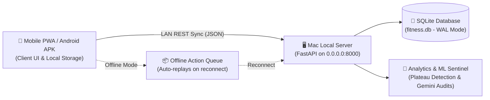
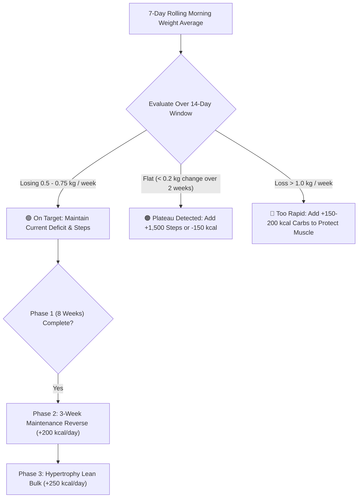

<div align="center">

# ⚡ mylife
### High-Performance Fitness, Hypertrophy & Metabolic Recomposition Architecture

[](https://fastapi.tiangolo.com)
[](https://www.python.org)
[](https://tailwindcss.com)
[](https://www.sqlite.org)
[](https://capacitorjs.com)
[](LICENSE)

*An Apple Fitness+ & Apple Health inspired body recomposition system engineered for serious lifters, offering offline-first PWA logging, local LAN synchronization, neural biofeedback auditing, and evidence-based periodization.*

</div>

---

## 📖 Table of Contents
1. [Overview & Philosophy](#-overview--philosophy)
2. [Example Athlete Specification](#-example-athlete-specification-demo)
3. [Core Capabilities & Interface Modules](#-core-capabilities--interface-modules)
4. [System Architecture](#-system-architecture)
5. [Directory Layout](#-directory-layout)
6. [Quickstart & Local Installation](#-quickstart--local-installation)
7. [REST API Documentation](#-rest-api-documentation)
8. [Offline-First Synchronization Engine](#-offline-first-synchronization-engine)
9. [Mobile App Packaging (Android APK)](#-mobile-app-packaging-android-apk)
10. [Automated Decision Matrix & Periodization](#-automated-decision-matrix--periodization)
11. [License & Disclaimer](#-license--disclaimer)

---

## 🎯 Overview & Philosophy

**mylife** was engineered to replace clunky, ad-saturated commercial fitness trackers with a distraction-free, scientific performance dashboard. Designed with an ultra-clean **Apple Fitness+** aesthetic, it features:
* **True Pitch-Black Theme (`#000000`)** with vivid lime, cyan, and amber data rings.
* **Large Touch Targets & 30px+ Rounded Corners** optimized for one-thumb gym use.
* **Clean Display Typography** eliminating unnecessary badge clutter while keeping vital metrics legible at a glance.
* **Zero Cloud Dependency**: Runs on a local Mac or private server; logs sync when you connect to your home Wi-Fi and cache automatically in local storage when training offline.



---

## 👤 Example Athlete Specification (Demo)

All documentation, sample datasets, and default profiles within this repository utilize the standardized athlete profile below:

| Dimension | Specification |
| :--- | :--- |
| **Athlete Name** | **Alex Miller** |
| **Age & Gender** | 25 Years Old • Male |
| **Height** | 178 cm (5' 10") |
| **Starting Scale Weight** | 82.0 kg (180.7 lbs) |
| **Current Phase** | **Phase 1: 8-Week Cutting Phase** |
| **Goal Target Weight** | 75.0 kg – 76.0 kg (165 – 167 lbs) |
| **Target Deficit** | -500 kcal/day (Target: ~1,950 kcal / TDEE ~2,450 kcal) |
| **Daily Macro Floor** | **165g Protein** (2.0g/kg) • **55g Fat** • **200g Carbs** |
| **Daily NEAT Target** | **10,000 Steps / Day** |
| **Training Protocol** | 4-Day Upper / Lower Split (2-Set Double Progression) |

---

## ✨ Core Capabilities & Interface Modules

### 1. Studio Workout & Real-Time Set Tracker
* **Session Cards**: View scheduled movements, muscle targets, and warm-up recommendations.
* **2-Set Double Progression**:
  * **Top Set**: 6–8 reps at 1–2 RIR (Reps In Reserve) for maximum mechanical tension.
  * **Back-off Set**: -10% to -15% load for 8–10 reps to drive volume without joint strain.
* **In-App Rest Timers & Audio Cues**: Crisp interval alerts between intense working sets.

### 2. Interactive Nutrition & Meal Adherence Modal
* **Meal Checklists**: Click on any scheduled meal (Breakfast, Lunch, Pre-Workout, Post-Workout, Dinner) to confirm compliance.
* **Dynamic Extra Food Logging**: Ingest unexpected foods with immediate macro breakdowns:
  * Protein (g), Carbohydrates (g), Sugar (g), Fat (g), and Total Calories.
* **Macro Goal Progress**: Live radial progress rings updating against daily targets (165g Protein, 1,950 kcal).

### 3. Neural Biofeedback & Readiness Engine
* **Tactile Recovery Sliders**: Log sleep quality, central nervous system (CNS) fatigue, and muscular soreness.
* **Pain & Soreness Mapping**: Pinpoint specific muscular strains (traps, neck, lower back, knees) to proactively prevent overtraining.
* **Readiness Score Index**: Automated 1–10 calculation weighting sleep, soreness, and calorie intake to determine daily training volume capacity.

### 4. Adaptive Taper Sentinel & Visual Insights
* **7-Day Rolling Weight Averages**: Filter out transient water and sodium fluctuations using mathematical rolling averages.
* **Dynamic SVG Bezier Sparkline**: Visual weight progression curve rendered in high-definition SVG.
* **Automated Coaching Triggers**:
  * *Plateau Alert*: Detects flat scale weight (< 0.2 kg delta) over 14 days and triggers step increases or macro adjustments.
  * *Rapid Loss Warning*: Alerts when loss exceeds > 1.0 kg/week to protect lean muscle mass.
* **One-Click Gemini AI Audit Export**: Packages recent macro compliance, biofeedback, and progressive overload data into a formatted markdown prompt for deep LLM analysis.

### 5. Concealed Athlete & Backend Control Drawer
* Smooth slide-in drawer anchored to the top-right header (`☰`).
* Displays athlete biometrics, phase prescriptions, and live Mac LAN connectivity status.
* Contains administrative actions: Manual Offline Sync, ML Training Dataset Download (`ml_fitness_dataset.json`), and Mac IP configuration.

---

## 🏗️ System Architecture

```
┌─────────────────────────────────────────────────────────────┐
│                       CLIENT TIER                           │
│  - Vanilla JavaScript (ES6 Modules, Zero Node Build Step)   │
│  - Tailwind CSS + Apple Typography Tokens                   │
│  - Progressive Web App (PWA) Manifest + Service Worker      │
│  - LocalStorage Queue for Resilient Offline Execution       │
└──────────────────────────────┬──────────────────────────────┘
                               │ HTTP / WebSocket (Port 8000)
┌──────────────────────────────▼──────────────────────────────┐
│                       SERVER TIER                           │
│  - Python 3.10+ with FastAPI Framework                     │
│  - Uvicorn Asynchronous ASGI Web Server                     │
│  - RESTful Data Ingestion & Batch Synchronization Routes    │
│  - Analytics Engine with Rolling Averages & Plateau Logic   │
└──────────────────────────────┬──────────────────────────────┘
                               │ SQLite3 Engine
┌──────────────────────────────▼──────────────────────────────┐
│                       DATA TIER                             │
│  - fitness.db (Embedded Relational Store)                   │
│  - Tables: user_profile, daily_metrics, workout_logs,       │
│            meal_logs, food_items, quotes                    │
│  - Auto-Migrating DDL on Startup with Foreign Key Integrity │
└─────────────────────────────────────────────────────────────┘
```

---

## 📁 Directory Layout

```bash
fitness_planner/
├── server/
│   ├── main.py                   # FastAPI REST API endpoints & sync router
│   ├── database.py               # SQLite initialization, schema migrations & models
│   ├── analytics.py              # Rolling averages, plateau algorithms & Gemini exporter
│   └── seed_quotes.py            # Motivational stoic and training quotes
├── static/
│   ├── index.html                # Single-page application shell & modal dialogs
│   ├── styles.css                # Apple Fitness+ theme, typography & micro-animations
│   ├── app.js                    # UI state management, audio timers & sync logic
│   ├── sw.js                     # Service Worker for offline asset caching
│   ├── manifest.json             # Web App Manifest for native mobile home-screen install
│   └── favicon.svg               # Vector brand iconography
├── COACHING_GUIDE.md             # Periodization frameworks, refeed rules & taper logic
├── NUTRITION_AND_SWAP_GUIDE.md   # Macro database, food swaps & dining out strategies
├── WORKOUT_PROGRAM.md            # Complete 4-day hypertrophy split & exercise bank
├── WEEKLY_CHECKIN_TEMPLATE.md    # Template for Sunday progress audits
├── PROFILE_SAMPLE.md             # Standardized demo athlete profile (Alex Miller)
├── run_server.py                 # Multi-platform development server runner
├── tracker.py                    # Terminal CLI utility for quick terminal logging
├── requirements.txt              # Python package dependencies
├── .gitignore                    # Comprehensive ignore rules (keeps personal data private)
└── README.md                     # System documentation & developer guide
```

---

## 🚀 Quickstart & Local Installation

### Prerequisites
* **Python 3.10+** installed
* **Git** installed
* Modern browser (Safari, Chrome, Firefox, or Edge)

### 1. Clone the Repository
```bash
git clone https://github.com/AnujDalvi82/mylife-fitness-planner.git
cd mylife-fitness-planner
```

### 2. Install Python Dependencies
```bash
pip install -r requirements.txt
```
*(Or install directly: `pip install fastapi uvicorn pydantic`)*

### 3. Initialize Database & Seed Content
```bash
python3 -m server.database
python3 -m server.seed_quotes
```

### 4. Launch Development Server
```bash
python3 run_server.py
```
* The server will boot on `http://0.0.0.0:8000`.
* **Mac Local Access**: Open [http://localhost:8000](http://localhost:8000)
* **Phone / Tablet on Same Wi-Fi**: Open `http://<YOUR_MAC_LAN_IP>:8000` (e.g. `http://192.168.0.104:8000`)

---

## 📡 REST API Documentation

| Method | Endpoint | Description |
| :--- | :--- | :--- |
| `GET` | `/api/ping` | Health-check endpoint returning server connectivity status. |
| `GET` | `/api/profile` | Fetches active athlete profile (age, weight, macro goals). |
| `POST` | `/api/sync` | Batch ingestion endpoint for offline metrics, workouts, and meals. |
| `GET` | `/api/metrics/today` | Retrieves logged morning weight, steps, sleep, and biofeedback for today. |
| `POST` | `/api/metrics` | Records or updates daily physical biometrics. |
| `GET` | `/api/workout/today` | Fetches today's completed sets, load, and exercise notes. |
| `POST` | `/api/workout` | Logs completed workout session details. |
| `GET` | `/api/meals/today` | Returns macro totals and checklist status for current date. |
| `POST` | `/api/meals/item` | Adds specific prescribed or custom extra food items with P/C/Sugar/Fat. |
| `GET` | `/api/analytics/rolling-weights` | Returns 7-day rolling weight averages and coach recommendations. |
| `GET` | `/api/analytics/ml-dataset` | Exports high-dimensional training dataset in JSON format. |
| `GET` | `/api/analytics/gemini-report` | Generates structured audit prompt for Gemini LLM weekly review. |
| `GET` | `/api/quote/random` | Returns a random stoic mindset or training quote. |

---

## 🔄 Offline-First Synchronization Engine

```
[User Action in Gym] ──► [Save to LocalStorage] ──► [Ping Mac /api/ping]
                                                          │
                             ┌────────────────────────────┴───────────────────────────┐
                             ▼ (Success)                                              ▼ (Fail / Offline)
                     [Send /api/sync Batch]                                  [Keep in Offline Queue]
                             │                                                        │
                     [Clear Local Queue]                                      [Badge: "Saved Offline"]
                             │                                                        │
                     [Update UI Rings]                                       [Retry on Reconnection]
```

* **Zero Data Loss**: When logging sets or meals without an active network connection, payloads are safely queued in `localStorage`.
* **Automatic Replay**: Upon regaining connection to your host Mac, the queue flushes automatically via `/api/sync`.

---

## 📱 Mobile App Packaging (Android APK)

The frontend is built to Capacitor specifications, allowing it to be compiled into a standalone Android APK:

1. **Install Capacitor CLI**:
   ```bash
   npm init -y
   npm install @capacitor/core @capacitor/cli @capacitor/android
   npx cap init "mylife" "com.athlete.mylife" --web-dir static
   npx cap add android
   ```

2. **Allow Local LAN HTTP Traffic**:
   In `android/app/src/main/AndroidManifest.xml`, ensure `usesCleartextTraffic` is enabled:
   ```xml
   <application
       android:usesCleartextTraffic="true"
       ... >
   ```

3. **Compile Debug APK**:
   ```bash
   cd android && ./gradlew assembleDebug
   ```
   The resulting `.apk` can be installed directly on any Android device.

---

## 📈 Automated Decision Matrix & Periodization



---

## 📄 License & Disclaimer

* **License**: Distributed under the MIT License. See `LICENSE` for details.
* **Disclaimer**: This software is intended strictly for personal tracking, habit formation, and educational athletic purposes. It does not provide medical diagnoses or replace guidance from healthcare professionals.
